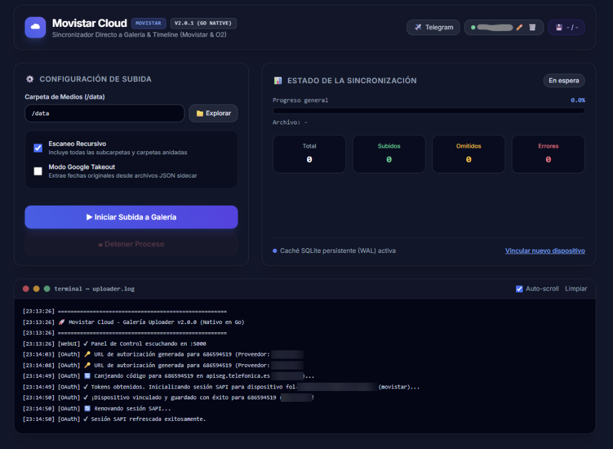

# Movistar / O2 Cloud Gallery Uploader ☁️

[](https://hub.docker.com/r/uniextra/movistar-cloud)
[](https://opensource.org/licenses/MIT)

A high-performance, lightweight, and Dockerized Go-native solution to automatically bulk-upload photos and videos to **Movistar Cloud** and **O2 Cloud España**, replicating the behavior of the native Android Gallery app (pure Gallery timeline objects, completely bypassing the virtual filesystem).

<p align="center">
  
</p>

---

## 🌟 Key Features

### ⚡ 100% Native Go & Ultra-Lightweight (~22 MB)
Rewritten from Python/Chromium/VNC to a compiled static Go binary:
- **Image size reduced from ~1.3 GB to ~22 MB**.
- **Memory footprint < 30 MB RAM** during multi-gigabyte uploads thanks to zero-copy `io.Pipe()` multipart streaming.
- **Single Port**: Only port `5000` is exposed. No virtual desktop, Chromium, or VNC dependencies.

### 🌐 Multi-Provider Support (Movistar & O2 Cloud)
- First-class support for both **Movistar Cloud** (`micloud.movistar.es`) and **O2 Cloud** (`cloud.o2online.es`).
- Dynamic provider selector in the Web UI adapting PKCE login URLs, token exchange, and upload endpoints.

### 🔑 Official Telefonica OAuth2 PKCE Login
Replicates the official Movistar & O2 Windows Desktop Client authentication:
- Generates a persistent official Device ID (`fol-...`).
- Seamless 3-step OAuth2 PKCE authorization modal via official `apiseg.telefonica.es` endpoints.
- Auto-rotates access and refresh tokens indefinitely.

### ✈️ Telegram Push Alerts
- Built-in Telegram notifier for instant alerts upon upload task completion or session expiration.
- Dedicated configuration modal with an instant test alert trigger.

### 📸 Pure Gallery Timeline Ingestion
Reverse-engineered SAPI upload protocol:
- By deliberately omitting `folderid` from the metadata JSON, media is ingested straight into the user's Gallery Timeline.
- Photos and videos never clutter the generic "Ficheros/Files" directory view.

### 📦 Advanced Google Takeout Mode
Ported from `immich-go` and Google Takeout reverse engineering findings:
- Filters junk thumbnails (`<40KB` or thumbnail filenames).
- Discovers original capture timestamps across 5 rules:
  1. Standard sidecars and supplemental metadata (`.supplemental-metadata.json`, `-supplemental-metadata.json`).
  2. Bracket swapping for duplicates (`IMG_1234(1).jpg` ↔ `IMG_1234.jpg(1).json`).
  3. Google Takeout 46/47/51 character truncation limits.
  4. Edited photo fallbacks (`-edited`).
  5. Motion photo / Live photo cross-extension pairing (`.mp4`/`.mov` paired with `.heic`/`.jpg`).
- Automatic video fallback using modification timestamps (`patchCreationDateForVideos`).

### 🧠 Smart Multi-Account SQLite Cache (WAL)
- Isolated cache database per phone account (`/app/tokens/cache_<phone>.sqlite`).
- Pre-queries cloud gallery inventory on startup to prevent duplicate uploads.
- Double-check: indexed path/size lookup + MD5 twin detection.

---

## 🐳 Docker Deployment

### Using Docker CLI

```bash
docker run -d \
  --name movistar-uploader \
  --restart unless-stopped \
  -p 5000:5000 \
  -v /ruta/a/tus/fotos:/data \
  -v movistar_tokens:/app/tokens \
  uniextra/movistar-cloud:latest
```

### Using Docker Compose

```yaml
version: '3.8'

services:
  movistar-uploader:
    image: uniextra/movistar-cloud:latest
    container_name: movistar-uploader
    restart: unless-stopped
    ports:
      - "5000:5000"
    volumes:
      - /path/to/your/photos:/data
      - movistar_tokens:/app/tokens

volumes:
  movistar_tokens:
```

---

## 📖 Usage Guide

1. Open your browser at `http://SERVER_IP:5000`.
2. Enter your mobile phone number in the initial prompt.
3. If connecting for the first time, click **Vincular Dispositivo (OAuth2)**:
   - Click **Generar Enlace Seguro de Telefónica**.
   - Open the link, sign in on the official Movistar page via SMS or password.
   - Copy the resulting URL or authorization code, paste it into Step 3, and confirm.
4. Select your media folder under `/data` (use the built-in Folder Browser).
5. Toggle **Escaneo Recursivo** or **Modo Google Takeout** as needed.
6. Click **▶ Iniciar Subida a Galería** and monitor live progress in the real-time terminal!

---

## ⚠️ Disclaimer
This is an educational, reverse-engineered open source project. It is not affiliated with, endorsed by, or maintained by Telefónica or Movistar.
